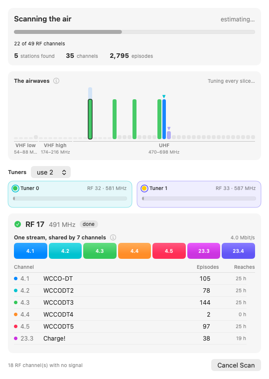

# OTAScanView

The over-the-air scan window ("Over-the-Air Scan", id `ota-scan`, 520×700, title bar, `.floating` level via `WindowAction`). It opens when an
OTA scan starts (`AppState.otaWindowRequest`; a scheduled or API-started scan opens it without taking focus). Deliberately not a modal: a
blocking modal would stop the web server and recording start/stop (the "No blocking dialogs" invariant); a floating window stays in front
but the app keeps running. Fed by `OTAScanEvent`s through `OTAScanProgress` (`OTAGuide/OTAScanProgress.swift`).

(Rendered from a test fixture, so the numbers are not real; the tuner bars are empty because it is a still frame.)

## Motion (reworked 2026-10-21; replaces "Kept calm")
The window is deliberately lively but cheap: motion is spring animation on *state changes*, never a redraw loop. Bars on the dial spring up (response 0.55, damping 0.6)
when a station is found; the arrow over the channel being read pops in and out and bobs (a single `repeatForever` animation, only while a scan runs); the
channel blocks of a multiplex slide in one after another (60 ms apart) whenever a different multiplex is shown. With **Reduce Motion** on, nothing bobs and
the blocks appear at once. The overall bar and each tuner's bar still fill linearly (redrawn every 2 s); a running station's numbers are redrawn at most every
4 s (`OTAScanProgress.updateEvery`); the selected multiplex changes only when a tuner **starts** on a station (an update from the other tuner never moves it).
No ticking clock while a scan runs (the time left is rounded to whole minutes; "took 14:20" appears at the end).

## Layout, top to bottom (540×760)
1. **Overview card.** A title ("Scanning the air", "Reading the channel list" for a lineup-only scan; "Scan complete" / "Scan cancelled" afterwards),
   a *Pass 1 of 2 · channel lists* / *Pass 2 of 2 · guides* chip for a full scan, and the time estimate at the right ("about 6 min left";
   "estimating…" until there is something to go on; "took 14:20" afterwards). **One progress bar** (`ota-scan-progress`, value "N of M RF
   channels" / "stations"): stations finished **plus the part-way reads on each tuner** (`OTAScanProgress.fraction`). Under it the count, then running totals:
   stations found, channels, episodes. The estimate restarts with each pass.
2. **The airwaves dial** (`OTASpectrumDial`, `ota-scan-dial`; the (i) explains the spectrum, RF channels and multiplexes). One slim bar per RF channel
   (`OTAScanner.allRFChannels`, 2–36 and 38–51), left to right in frequency order, with the three bands named underneath: VHF low (RF 2–6, 54–88 MHz), VHF high (7–13,
   174–216 MHz), UHF (14–51, 470–698 MHz). A bar is a faint tick until heard (`OTAScanProgress.listenedRF`), a dimmer tick when nothing was on it
   (`emptyRF`), a short bar in the tuner's colour with a bobbing arrow while being read, and a tall bar once a station is found (taller with more channels, up to 6; blue
   while its guide is still being read, green when done). The selected bar is outlined; tapping a found bar selects it (`ota-scan-tab-<RF>`).
3. **Tuners.** A *Tuners* row with the **use N** pulldown (`ota-scan-tuners`, 1…tuner count; lowering it lets the read in progress finish and then idles that tuner,
   raising it starts the other within a second) and, at the right, why nothing is being read when that is so (`progress.note`). Then **one slim chip per tuner**
   (`ota-scan-lane-<n>`), each in its own colour (teal, indigo, pink, brown): a light (green reading, yellow locking on, orange stepped aside, grey idle/off/done), the RF
   channel and frequency it is on, and a **progress bar for that read** (`ota-scan-lane-progress-<n>`: time so far against the longest it can take; a read often
   ends sooner, so it may jump to full). The arrow on the dial has the same colour.
4. **The selected multiplex** (`ota-scan-mux-<RF>`). Header: RF number, frequency, state chip, a **Follow** button when you picked one yourself while a scan runs
   (`ota-scan-follow`), signal bars (`ota-scan-signal`). Then **"One stream, shared by N channels"** with an (i) explaining multiplexes and sub-channel numbers: one coloured
   block per channel (`ChannelChips`, the colour repeated as the dot in the list below), and the stream's data rate. Then the **channel table**
   (`ota-scan-sub-<number>`: number, name, a speaker icon for audio-only channels, episodes listed, how far ahead each reaches, "no guide" when it has none).
   With nothing found yet it says "Listening for stations…".
5. **Footer.** Count of RF channels with no signal; Cancel Scan while running, Close when done.

Channels of one station are read together from one stream, so they finish together. (Removed in this rework: the per-tuner station cards, the station tabs strip, the three
summary tiles and the technical footnote — data rate is now beside the stream, the clock comparison is gone.)

## Data
`OTAScanEvent`: `queued`, `started(rf, tuner, expectedSeconds)` (puts a station on a tuner's lane), `update` / `finished` (the decode so far, bytes, seconds),
`signal` (the tuner's own reading, taken about two seconds in), `paused` (a read interrupted because a tuner was needed; it goes back in the queue),
`skipped`, `note`. `OTAScanLane` (station, start time, expected length) is what a lane draws from; `OTAMuxInfo` holds a station's facts.

## Automation
Accessibility identifiers: `ota-scan-window`, `ota-scan-progress`, `ota-scan-count`, `ota-scan-time-left`, `ota-scan-status`, `ota-scan-tuners`,
`ota-scan-lane-<n>` / `ota-scan-lane-progress-<n>`, `ota-scan-multiplexes` / `-channels` / `-listings` (label + value), `ota-scan-dial`, `ota-scan-tab-<RF>` (a dial bar),
`ota-scan-mux-<RF>` (the selected multiplex's panel), `ota-scan-follow`, `ota-scan-signal`, `ota-scan-sub-<number>`,
`ota-scan-cancel`, `ota-scan-close`. Settings: `settings-ota-scan`, `settings-ota-lineup-scan`, `settings-ota-cancel`, `settings-ota-schedule`.
Without the UI: `POST /api/ota-scan` / `GET /api/ota-status` (docs/OTAGuide.md).
